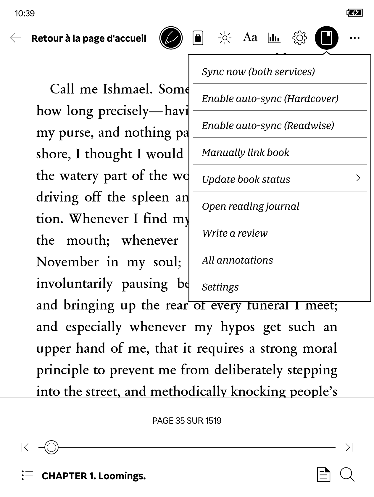

# Bookwise Nickel — Hardcover and Readwise Books on Kobo

Sync your Kobo reading with **Hardcover**, **Readwise Books**, or **both at once**,
straight from the reading menu.

> This is a fork of [StrayRose's NickelHardcover](https://codeberg.org/StrayRose/NickelHardcover).
> It keeps every Hardcover feature and adds Readwise Books.

> **Before you start**
>
> - This is an **experimental release**. Back up your Kobo data before installing.
> - **Kobo firmware 5.x is not supported.** The Kobo Mini (2012) is not supported either.
> - NickelMenu is **not** required.

## Contents

1. [What it does](#what-it-does)
2. [Quick start](#quick-start)
3. [Step 1 — Check the requirements](#step-1--check-the-requirements)
4. [Step 2 — Install the plugin](#step-2--install-the-plugin)
5. [Step 3 — Choose a sync mode](#step-3--choose-a-sync-mode)
6. [Step 4 — Connect Hardcover](#step-4--connect-hardcover)
7. [Step 5 — Connect Readwise Books](#step-5--connect-readwise-books)
8. [Step 6 — Send your first session](#step-6--send-your-first-session)
9. [Everyday use](#everyday-use)
10. [Settings reference](#settings-reference)
11. [Troubleshooting](#troubleshooting)
12. [Updating, switching mode and uninstalling](#updating-switching-mode-and-uninstalling)

## What it does

| | Hardcover | Readwise Books |
| --- | :---: | :---: |
| Reading progress | ✅ | ✅ |
| Reading session duration | — | ✅ |
| Status, star rating, review | ✅ | ✅ in Readwise-only mode |
| “Paused” status | ✅ | — |
| Reading journal and annotations (highlights, notes) | ✅ | — |
| Sign-in on the Kobo with a QR code | ✅ | — (token copied over USB) |
| Offline sessions kept across restarts | — (kept in memory only) | ✅ |

Both services work **independently**: each has its own account, book links and
upload queue, so a failure on one never undoes a successful sync on the other.

You can sync **on demand**, **automatically while reading**, or **when you close a
book** (putting the Kobo to sleep counts as closing).

> The Readwise integration uses **Readwise Books**. It does not use Readwise
> Reader or the Readwise highlights API, so your Kobo highlights are not sent to
> Readwise.

## Quick start

Already comfortable with Kobo plugins? Here is the whole process in short:

1. Copy `KoboRoot.tgz` (built from this fork) into `.kobo/` on your Kobo and eject it.
2. Edit `.adds/NickelHardcover/config.ini` and set `provider` to `dual`,
   `hardcover` or `readwise`.
3. For Readwise, paste your token from <https://readwise.io/access_token> into
   `readwise_token`.
4. For Hardcover, open a book and choose **Sign in to Hardcover.app** in the
   plugin menu.
5. Read a little, then choose **Sync now** in the plugin menu.

The steps below explain each of these in detail.

## Step 1 — Check the requirements

You need:

- [ ] A Kobo on firmware **4.x** (this fork was tested on **4.46.23852**).
- [ ] A USB cable and a computer.
- [ ] A **Hardcover** account and/or a **Readwise** account with access to
      Readwise Books.
- [ ] Wi-Fi on the Kobo to upload data (reading offline works fine).
- [ ] A **`KoboRoot.tgz` built from this fork**.

> **Where do I get `KoboRoot.tgz`?** No public download is provided for this fork
> yet. Downloads from the original NickelHardcover project **do not include
> Readwise**. Have the archive built from this repository, or follow the
> developer [build instructions](AGENTS.md#compilation-pour-kobo).

**Testing status:** this fork has only been tried on one Kobo. See the
[validation status and known limitations](AGENTS.md#etat-de-validation) before
relying on it.

## Step 2 — Install the plugin

1. **Connect your Kobo** to your computer and tap **Connect** on the Kobo screen.
2. **Show hidden files** so that the `.kobo` and `.adds` folders appear:
   - macOS: press **Cmd + Shift + .** in Finder;
   - Windows: in File Explorer, enable **View → Show → Hidden items**;
   - Linux: usually **Ctrl + H** in the file manager.
3. **Back up** these to your computer:
   - `.kobo/KoboReader.sqlite`;
   - the `.adds/NickelHardcover/` folder, if it already exists.
4. **Copy `KoboRoot.tgz` into the `.kobo/` folder.** Do not extract it.
5. **Safely eject** the Kobo, unplug it and wait for it to restart. The
   installation happens during this restart.

> **Already using NickelHardcover?** This fork replaces it and uses the same
> folders. Install over it directly: your settings and Hardcover sign-in are kept.
> Do not install both plugins side by side.

## Step 3 — Choose a sync mode

All settings live in **`.adds/NickelHardcover/config.ini`** on the Kobo. The
`provider` setting chooses which services are used:

| `provider =` | Syncs to | Choose it if… |
| --- | --- | --- |
| `hardcover` *(default)* | Hardcover only | you only use Hardcover |
| `readwise` | Readwise Books only | you only use Readwise |
| `dual` | Hardcover **and** Readwise Books | you want both |

To edit the file:

1. Connect the Kobo over USB.
2. Open `.adds/NickelHardcover/config.ini` in a plain text editor (TextEdit in
   plain-text mode, Notepad, gedit…). If the file does not exist, create it, and
   make sure it is not saved as `config.ini.txt`.
3. Set the `provider` line. If it already exists, **change it rather than adding
   a second one**.
4. Safely eject the Kobo, then **close and reopen your book**. Settings are read
   when a book opens.

Switching modes later never deletes your tokens or book links.

## Step 4 — Connect Hardcover

*Skip this step in `readwise` mode.*

**If NickelHardcover was already signed in**, you have nothing to do. Keep the
existing `access_token`, `refresh_token` and `token_expires_at` lines in
`config.ini`.

**Otherwise:**

1. Open a book and [open the plugin menu](#opening-the-plugin-menu).
2. Choose **Sign in to Hardcover.app**.
3. Scan the QR code with your phone (or open the displayed link and enter the
   code), and authorize access.
4. Tap **Continue** on the Kobo.

## Step 5 — Connect Readwise Books

*Skip this step in `hardcover` mode.*

Readwise does not have a QR code sign-in yet: you copy a personal token into
`config.ini` over USB. (In dual mode, the **Sign in to Readwise Books** menu
entry reminds you of these steps.)

1. On your computer, sign in to Readwise and open
   <https://readwise.io/access_token>. Copy your **personal token**.
2. Connect the Kobo over USB and open `.adds/NickelHardcover/config.ini`.
3. Add or update these lines. Replace `YOUR_PERSONAL_TOKEN` with your token, keep
   your other existing lines, and do not create duplicates:

   ```ini
   ; dual = Hardcover + Readwise. Use "readwise" for Readwise only.
   provider = dual
   readwise_token = YOUR_PERSONAL_TOKEN

   ; Sessions appear in your Readwise Books feed. Set to false to hide them.
   readwise_publish_to_feed = true

   ; Recommended automatic sync settings (explained in "Settings reference").
   auto_sync_default = false
   retry_on_network = true
   sync_on_close = 1
   sync_on_read = 20
   sync_on_schedule = -1
   ```

4. Safely eject the Kobo, then close and reopen your book.

> **Keep your token private.** It is stored in plain text on the Kobo. Never share
> `config.ini` or your token in an issue, a screenshot or a chat.
>
> **Feed visibility:** sessions are **published to your Readwise Books feed by
> default**. To keep them private, set `readwise_publish_to_feed = false`
> *before* reading. They still count in your Readwise statistics and
> leaderboards. Sessions already waiting to be uploaded keep the setting they
> were recorded with.

## Step 6 — Send your first session

1. **Turn on Wi-Fi** on your Kobo.
2. **Open a book and read** until the progress percentage goes up. A few pages
   may not be enough.
3. **Without leaving the book**, open the plugin menu and choose
   **Sync now (both services)** in dual mode, or **Sync now** in single-service
   mode.
4. **Check the result:**
   - in Hardcover, the book's progress is updated (Hardcover ignores progress
     below 2%);
   - in Readwise Books, a new reading session appears on the right book (Readwise
     records sessions even at 0–1%).

If the wrong book was matched, see [Linking the right book](#linking-the-right-book).

## Everyday use

### Opening the plugin menu

Open a book, tap the middle of the screen to show the reading toolbar, then tap
the plugin icon **at the top right**. Menu labels are in English.



*Screenshot from the original Hardcover-only project. In dual mode, Readwise
entries are added at the bottom of this menu.*

### Which menu entry affects which service?

| Menu entry | `dual` mode | Single-service mode |
| --- | --- | --- |
| **Sync now (both services)** / **Sync now** | Both services | That service |
| **Enable auto-sync (Hardcover)** | Hardcover | — |
| **Enable auto-sync (Readwise)** | Readwise | — |
| **Enable auto-sync** | — | That service |
| **Manually link book** / **Unlink book** | Hardcover | That service |
| **Update book status** | Hardcover | That service (“Paused” is Hardcover only) |
| **Write a review** (stars + review) | Hardcover | That service |
| **Open reading journal**, **All annotations** | Hardcover | Hardcover only |
| **Settings** | Both | That service |

In dual mode, statuses and reviews are **not** copied to Readwise.

### Syncing manually

Choose **Sync now** before you close the book or put the Kobo to sleep. A manual
sync also uploads Readwise sessions saved earlier for other books.

> **Important:** if you only sync manually, do it **before leaving the book**. A
> Readwise session is saved automatically on closing **only if Readwise
> auto-sync is enabled for that book**. Enabling Hardcover auto-sync alone is not
> enough.

### Syncing automatically

Auto-sync is turned on **per book**, and in dual mode **per service**:

- In dual mode, enable both **Enable auto-sync (Hardcover)** and
  **Enable auto-sync (Readwise)** for the book you are reading.
- In single-service mode, choose **Enable auto-sync**.
- The matching **Disable auto-sync** entry turns it off again.

With the recommended settings from [Step 5](#step-5--connect-readwise-books), a
sync happens:

- when you **close the book or put the Kobo to sleep**, if progress went up by at
  least 1 percentage point;
- **while reading**, every 20 percentage points;
- **when Wi-Fi comes back**, for uploads that failed for lack of a connection.

The thresholds are shared, but each service compares them with its own last
synced progress. You can change them, set a daily sync time, or enable
**Enable auto-sync by default for new books** in the plugin's **Settings**.

**Reading offline:** completed Readwise sessions are saved on the Kobo and
uploaded later, even after a restart. Reconnect to Wi-Fi and use **Sync now** if
needed. Hardcover's retry queue is kept in memory only, as in the original
project, so it is lost on restart.

**Finishing a book:** Hardcover rounds 99% up to 100% and then turns its
auto-sync off. Readwise keeps 99% as is and its auto-sync stays on. To mark a
book as finished in Readwise, do it in Readwise Books or use **Read** in
Readwise-only mode.

### Linking the right book

**Hardcover:** choose **Manually link book**, then search for and select the book
or edition. In dual mode this never replaces an existing Readwise link.

**Readwise:** the plugin finds the book by ISBN/ASIN, or by title and author if
there is no ISBN. If it picks the wrong one:

1. Add the right book to your **Readwise Books library** first. Search only
   covers your library, not the whole Readwise catalog.
2. In dual mode, temporarily set `provider = readwise` over USB, then close and
   reopen the book.
3. If the book is already linked, choose **Unlink book** first.
4. Choose **Manually link book**, search for the book and select it.
5. If you changed mode, set `provider = dual` again over USB, then close and
   reopen the book.

Notes:

- Without an ISBN, a first sync (which sends the title and author) may be needed
  before you can rate the book.
- Sessions already saved keep the link they were recorded with. To fix the link
  of a session that has not been uploaded yet, follow the
  [advanced procedure](AGENTS.md#recuperation-des-sessions-readwise) instead of
  resending it blindly.

### Signing out

In the plugin's **Settings**, signing out of the main account signs out of
Hardcover in dual mode. The **Readwise Books** row signs out of Readwise
separately.

## Settings reference

All keys go in `.adds/NickelHardcover/config.ini`. The plugin's **Settings**
screen changes most of them for you.

| Key | Values | Meaning |
| --- | --- | --- |
| `provider` | `hardcover` (default), `readwise`, `dual` | Services to sync |
| `readwise_token` | your personal token | Readwise sign-in |
| `readwise_publish_to_feed` | `true` (default), `false` | Show sessions in your Readwise Books feed |
| `auto_sync_default` | `true`, `false` | Turn auto-sync on automatically for new books |
| `retry_on_network` | `true`, `false` | Retry failed uploads when Wi-Fi reconnects |
| `sync_on_close` | `1`–`99`, `-1` = off | Sync on close/sleep after this many percentage points of progress |
| `sync_on_read` | `1`–`99`, `-1` = off | Sync while reading after this many percentage points |
| `sync_on_schedule` | `0`–`23`, `-1` = off | Daily sync at this hour, even while asleep |
| `journal_privacy` | `account`, `public`, `follows`, `private` | Hardcover journal visibility |
| `sync_annotations` | `true`, `false` | Send Kobo highlights and notes to the Hardcover journal |
| `access_token`, `refresh_token`, `token_expires_at` | set by sign-in | Hardcover sign-in; do not edit by hand |

> If a key is missing, some features (network retries, annotations, automatic
> triggers) may be off. Start from the example in [Step 5](#step-5--connect-readwise-books)
> to be safe.

## Troubleshooting

**The plugin asks me to sign in to Hardcover, but I only want Readwise.**
Hardcover is the default mode, and dual mode also asks for it when it is missing.
Set `provider = readwise`, then close and reopen the book.

**No session appears in Readwise.**
Check, in order:

1. Wi-Fi is on.
2. `readwise_token` is correct and your account has access to Readwise Books.
3. The progress percentage actually went up while reading.
4. You synced **before leaving the book**, or **Readwise** auto-sync is enabled
   for that book.

Dual mode only sends **new** sessions: it does not rebuild your past reading
from Hardcover.

**The session duration looks wrong.**
Duration counts time spent on the reading screen, excluding sleep and other
screens. Leaving a book open without reading, or skipping pages, distorts it.
Completed sessions are safe, but an abrupt shutdown can lose the session in
progress.

**A message asks me to check a pending Readwise session.**
After a network interruption, the plugin may not know whether Readwise received a
session. To avoid duplicates, it pauses **Readwise** uploads (Hardcover keeps
working).

1. **Do not delete the queue and do not force a resend.**
2. Check in Readwise Books whether the session is there.
3. Back up `.adds/NickelHardcover/`.
4. Follow the [advanced recovery procedure](AGENTS.md#recuperation-des-sessions-readwise).

**Can I switch to another Readwise account?**
Not by just replacing the token: sessions from the old account could be sent to
the new one. Follow the [account-switching procedure](AGENTS.md#changer-de-compte-readwise).

**A book is not recognized, or has no cover.**
For safety, ISBN lookup reads at most 8 MiB of decompressed data per EPUB entry
and 32 MiB in total. For larger books, [link the book manually](#linking-the-right-book);
the EPUB itself is not changed and still reads normally on the Kobo.

Covers are only loaded as JPEG/PNG over HTTPS from the hosts allowed in
`hook/src/cover.cc`, up to 4 MiB, 4,194,304 pixels (4,096 per side), three
redirects and 30 seconds. Otherwise the cover stays blank, but the book can still
be selected. No cookies or credentials are sent to cover servers.

## Updating, switching mode and uninstalling

**Updating:** repeat [Step 2](#step-2--install-the-plugin) with the new
`KoboRoot.tgz`. No need to uninstall first; your configuration is kept.

**Going back to one service:** set `provider = hardcover` or `provider = readwise`,
then close and reopen the book. The other service stops syncing but keeps its
tokens and book links. Pending Readwise sessions stay on the Kobo; they are not
deleted or transferred to Hardcover.

**Uninstalling:**

1. Sync any sessions you want to keep.
2. Back up `.adds/NickelHardcover/`, then delete it from the Kobo over USB.
3. Safely eject the Kobo and restart it.

## Credits and development

Thanks to StrayRose for [NickelHardcover](https://codeberg.org/StrayRose/NickelHardcover)
and to pgaskin for [NickelHook](https://github.com/pgaskin/NickelHook) and
[NickelTC](https://github.com/pgaskin/NickelTC). The project is distributed under the
[MIT license](LICENSE), with the original copyright preserved.

The images in `screenshots/` come from the original Hardcover project and do not
show the Readwise integration. Build instructions, tests, architecture and technical
details are in [AGENTS.md](AGENTS.md).

## TODO

- [ ] Add Readwise Books sign-in via a QR code on the Kobo: scan it with a phone,
  sign in and authorize access through Readwise, then finish signing in on the
  e-reader without copying a token over USB.
  - Check [Readwise's](https://readwise.io/books_api) OAuth capabilities: Device
    Authorization Flow (unconfirmed), redirects, PKCE and token refresh.
  - Prefer a native Device Flow if available; otherwise, evaluate a temporary
    HTTPS pairing service and its hosting and security requirements.
  - Handle OAuth tokens with `Authorization: Bearer …`, expiration and
    authorization errors; keep personal-token configuration available.
  - Validate the complete flow on a real Kobo and phone.
